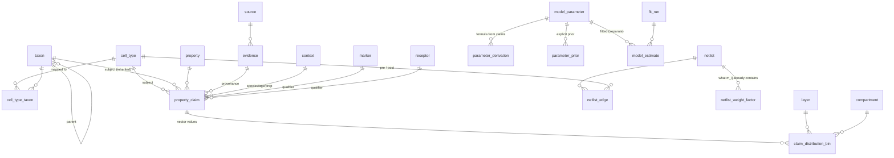

# Hippocampal interneuron knowledge base

A SQLite knowledge base that turns literature about the 53 inhibitory populations in `mij_netlist.csv` into **priors for the MPR/QIF neural-mass ODE**. It follows the rules in `../hippocampal_interneuron_neural_mass_project_knowledge.md`.

```
seed/*.csv  ──build_kb.py──▶  hippocampal_interneuron_kb.sqlite  ──resolver.KB──▶  Θ_i priors + W0  ──▶  ODE / continuation
(curated, diffable)            (schema.sql)                          (provenance per number)
```

## Files

| file | role |
|---|---|
| `schema.sql` | DDL: 30 tables, 3 views, 1 trigger |
| `query.py` | `describe()` / `find()`: what a cell does under a condition, at a location; `known()` / `findings()`: what experiments report, with primary references |
| `build_kb.py` | Loads the vocabularies, the netlist (85 populations, 1,641 edges) and the seed CSVs, then validates the result |
| `resolver.py` | `KB` class: hierarchical prior resolution, morphology vectors, coverage, sampling, ODE hand-off, curation helpers |
| `kb_demo.ipynb` | Walkthrough: bundles, coverage heatmap, morphology, ODE wiring check, sampling |
| `seed/taxon.csv`, `seed/cell_type_taxon.csv` | Family hierarchy, and the mapping of each of the 53 interneurons to a family (with confidence and rationale) |
| `seed/pelkey2017_*.csv`, `seed/condition.csv` | 301 claim rows (incl. function statements, circuit roles and 60 experimental findings), the 1,282-entry reference list, 125 distribution bins, and Table 1 (Tricoire clusters) from Pelkey et al. 2017, with page locators |
| `seed/model_parameter.csv`, `seed/parameter_derivation.csv`, `seed/parameter_prior.csv` | ODE parameter definitions, claim-to-parameter formulas, and explicit priors (literature-informed or flagged assumptions) |

```bash
cd database_design/kb
python build_kb.py                 # -> hippocampal_interneuron_kb.sqlite
python resolver.py                 # smoke test: prints four bundles
```

## Schema at a glance



Four layers, kept apart on purpose:

1. **Identity**: `cell_type` (exact netlist names, with region, layer and projection target parsed from the name), `taxon` (family hierarchy), `cell_type_taxon` (many-to-many, with confidence).
2. **Evidence**: `property_claim` holds *(subject, property, value, qualifiers, evidence, context, confidence)*. A claim's subject is either a cell type or a taxon. Vector-valued claims (laminar and compartment distributions) put their values in `claim_distribution_bin`. Markers are tri-state. Measured values, review summaries, curator inferences and modeling assumptions are different `evidence_class` values.
3. **Model**: `model_parameter` (the ODE's parameters), `parameter_derivation` (Python expressions over claim values), `parameter_prior` (explicit distributions at cell, taxon, region or global scope, optionally conditional on a marker), `model_estimate` (fitted values, never mixed with claims).
4. **Coupling**: `netlist_edge` stores `w_ij`, `kappa_j` and `m_ij`. `netlist_weight_factor` declares which biophysical factors are already folded into `m_ij`, so the resolver can warn about double counting.

## How ODE parameters are filled

| ODE parameter | source in the KB | current best evidence |
|---|---|---|
| τ | `tau_m · (V_th − V_rest) / V_scale` | Table 1 cluster means, at taxon level |
| η̄ | `−((V_th − V_rest) / 2V_scale)²` | Table 1 |
| Δ | `0.674 · SD(η)` (Lorentzian HWHM matched to the Gaussian IQR) | Table 1 SDs (an upper bound, because clusters pool cell types) |
| γ (input gain) | `R_in (V_th − V_rest) / V_scale²` | Table 1 |
| b | `π τ √|η| (1 − AR²) / AR` (QIF at 2× rheobase) | Table 1 adaptation ratio |
| τ_a | global assumption | **no data**: AHP half-width is not τ_a |
| τ_A | global fast default; NGF family = 10× (p.1678) | assumption, plus one ratio claim |
| τ_B | global assumption | **no data** |
| U_A | `release_probability` (PVBC 0.6, p.1660) | no netlist population maps to PVBC, so all 53 currently use the default |
| U_B | NGF family > 0 (p.1680); otherwise near 0 | sign from the literature, magnitude assumed |
| β_CB1 | conditional on CB1 marker: CCKBC > CCK dendrite-targeting (p.1686) | ordering from the literature, magnitude assumed |
| α^η, α^rel per receptor | signs from `receptor_effect` claims (M1/M3, M2, MOR, DOR, CCK2, OXTR, 5-HT3A, GABA_B ...) | sign from the literature, magnitude assumed |
| d_iℓ, a_jℓ, a_jc | `layer_profile()` from distribution claims | CA1 anatomy; never applied across region schemes |
| A_tot, v_cond | NGF 140,000 µm, PVBC 46,000 µm; PV 0.25–1.5 m/s | sparse |

`V_scale = 24.67 mV` is the mean of `V_th − V_rest` over the six Table 1 clusters. It is a global normalisation, not a cell property.

## Resolution rules (`resolver.KB.resolve`)

1. Candidates are collected from the exact population (rank 0), then each mapped taxon and its ancestors (rank 1 + depth). Secondary mappings add +1 rank.
2. A family that is molecularly unresolved (bare `Basket`) gets a **moment-matched mixture of its subtypes**, and only when every subtype has data. A placeholder family (`DT_UNRESOLVED`, `TRILAMINAR`) gets a **mixture of sibling families**. Marker-conditional priors never enter a mixture, so `CA1 Basket` never inherits CCK/CB1 modulation.
3. A marker counts as known only if claim confidence × mapping confidence ≥ 0.5. For example, `DG HICAP`'s secondary 0.4 mapping to CCKBC does not make it CB1+.
4. The chosen prior is widened: `var = var_min + (1 − c_eff)·var_unc`, where `c_eff = confidence × mapping × 0.9^depth`.
5. Each `Prior` carries `specificity`, `basis`, `source` (derivation or prior id), `evidence` (subject and page) and `warnings`.

## Things to check in the ODE notebook

- **κ_j double counting.** `m_ij = w_ij·κ_j`, and κ_j is the target's Izhikevich transfer slope. The MPR mass already has its own transfer function (τ, η, Δ), so using `m_ij` and the MPR gain together counts the target gain twice. Use `kb.ode_inputs(weight="w_ij")`, or keep `m_ij` and fix the MPR gain. This KB defaults to `m_ij` because that is the project-wide operator decision.
- **τ_ij is already in m_ij as charge.** Write the synapse as `τ_A ṡ = −s + U r` (steady-state gain independent of τ). The form `ṡ = −s/τ_A + U r` would count τ a second time.
- **c_ij is already in m_ij.** Do not multiply Ω_morph = Σ a·d into J again (project knowledge §27).
- **No VIP/CR interneuron-selective (ISI) populations are in the netlist.** The `ISI` taxon exists but nothing maps to it, so the VIP→SST disinhibitory motif is absent from the ODE.
- `CA1 Radiatum Giant` is flagged excitatory in the netlist.

## Coverage today (53 interneurons, required intrinsic parameters)

| level | τ, η, Δ, b |
|---|---|
| family claims (taxon d0/d1) | 30 |
| subtype mixture (bare basket types) | 6 |
| sibling mixture (unresolved dendrite-targeting, trilaminar) | 15 |
| global default (2 MEC interneurons) | 2 |

All 53 use global assumptions for τ_a, τ_B and U_A, and 48 do for τ_A and U_B. These are where new literature would help most.

## Functional queries (`query.py`)

```python
from resolver import KB
import query                                   # adds kb.describe() and kb.find()
kb = KB("hippocampal_interneuron_kb.sqlite")

kb.describe("CA1 O LM", condition="ACh", stimulus_at="distal", inhibits_at="distal")
kb.find(inhibits_at="distal", region="CA1", condition="opioid")      # DataFrame
kb.find(stimulus_at="TA")                                             # who does EC input recruit?
```

| argument | meaning | accepted values |
|---|---|---|
| `inhibits_at` | where the cell's output lands | `distal`, `proximal`, `perisomatic`, `AIS`, `soma`, `apical`, `oblique`, `basal`, `dendritic`, `volume`, or a layer code (`SLM`, `SR`, `SO`, `SP`, `SL`, `OML`, `MML`, `IML`, `SG`, `H`, `LI`–`LVI`) |
| `stimulus_at` | where input reaches the interneuron's dendrites | same as above, or a pathway: `SC`, `TA`, `NRe`, `PP`, `PP_CA3`, `MF`, `CA1_rec`, `CA3_rec`, `HC_assoc` |
| `condition` | state under which to read the cell | `ACh`, `5-HT`, `DA`, `eCB`, `opioid`, `CCK`, `OXT`, `GABA_B`, `theta`, `gamma`, `SWR`, `trains`, `CFC`, `navigation`; a receptor (`MOR`, `M1`, `CB1` ...); plain words (`acetylcholine`, `repetitive`); or a list of these |

`describe()` reports:
- the literature function statement and circuit role;
- where the output lands, and which afferent pathway it co-localises with (what it gates);
- what recruits the cell, from the dendrite–pathway overlap (feedforward vs feedback) and from the netlist's strongest drivers;
- the location verdict;
- each receptor effect under the condition, with its sign and the net direction (more inhibition vs disinhibition);
- caveats.

Every line carries `[subject page]`.

Limits:
- `stimulus_at` says whether input at that location reaches the cell's dendrites. It does not say how strongly the soma feels it, because proximal-vs-distal integration inside the interneuron is not modelled.
- Unresolved types (bare `Basket`) do not inherit PVBC- or CCKBC-specific function statements.
- Netlist output shares are per-target-population weights, not synapse counts, and are inflated toward interneuron targets by κ_j.

## What is a cell known to do? (`known()` / `findings()`)

```python
kb.known("CA1 O LM")                                     # everything, grouped by topic
kb.known("CA1 Bistratified", topic="oscillation")        # one topic
kb.known("CA1 Basket CCK+", condition="eCB").to_frame()  # as a DataFrame, with primary DOIs
kb.findings(condition="SWR")                             # across cells: who fires during ripples?
kb.findings(topic="disease", contains="epilep")
```

The topics are identity, anatomy, physiology, synaptic, function, neuromodulation, oscillation, plasticity, behavior and disease. Each line shows:
- the finding;
- the condition it holds under;
- the level it was reported at (cell or family);
- the review page;
- the evidence type;
- the confidence;
- the **primary papers** behind it, resolved from Pelkey's bibliography (all 1,282 references are in `review_reference`).

`findings()` lists each result once, at the level it was reported, along with the netlist populations that inherit it.

## Adding knowledge

```python
from resolver import KB
kb = KB("hippocampal_interneuron_kb.sqlite")
kb.db.execute("INSERT INTO source (short_ref, citation, doi, year, source_type) VALUES (?,?,?,?,?)", (...))
kb.add_claim("t:OLM", "tau_m", source="...", evidence_class="measurement", locator="Table 2",
             value_num=40.1, value_sd=9.0, n=12, stat="mean", confidence=0.8)
kb.record_estimates("theta fit v1", [("CA1 O LM", "tau", 41.2, 3.0)], observables="theta frequency")
```

For durable additions, add rows to a `seed/*.csv` file and rebuild, so the database can always be regenerated from version-controlled text.

## Suggested next sources

- **Hippocampome.org** (per-type markers, Izhikevich parameters, TPM synaptic constants g, τ_d, U, τ_r, τ_f). Fill `cell_type.hippocampome_id` first, then import these as cell-level claims (rank 0). This would replace most taxon-level and mixture priors.
- **Bezaire & Soltesz 2013** (CA1 counts, connectivity, morphology) for the CA1 anatomy that Pelkey cites only in summary.
- **Paired-recording literature** for τ_A, τ_B and U per presynaptic class. These are the largest gaps.
